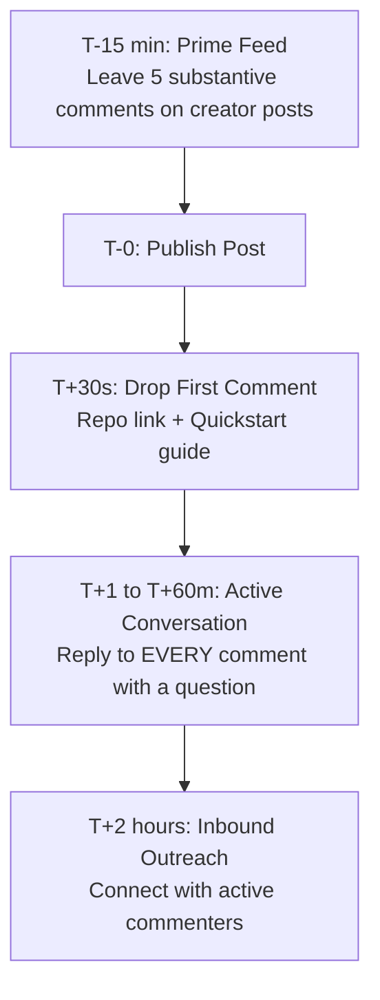

# 🚀 Inbox Sprint — Viral LinkedIn Launch Kit

A high-converting, authority-building LinkedIn launch strategy for **Inbox Sprint** — the retro-futuristic arcade web app that turns inbox triage into a 3-minute game powered by local AI and pure Node.js craftsmanship.

---

## 📌 Campaign Overview

| Attribute | Details |
| :--- | :--- |
| **Product** | **Inbox Sprint** |
| **Core Value Prop** | Eliminate inbox anxiety in a 3-minute retro-arcade sprint powered by private, local LLMs |
| **Primary Audience** | Software engineers, tech leads, founders, AI enthusiasts, and productivity obsessives |
| **Key Differentiators** | 100% Zero npm dependencies, 100% local AI support (LM Studio), reversible undo, arcade gamification |
| **GitHub Repo** | [https://github.com/ojaspurwar/PromptWar-Hackathon-Ojas-.git](https://github.com/ojaspurwar/PromptWar-Hackathon-Ojas-.git) |
| **Core Files** | [`server.js`](file:///C:/Users/Ojas_Purwar/Documents/PromptWars/server.js) · [`public/app.js`](file:///C:/Users/Ojas_Purwar/Documents/PromptWars/public/app.js) · [`README.md`](file:///C:/Users/Ojas_Purwar/Documents/PromptWars/README.md) |

---

## 🎣 Part 1: Three Scroll-Stopping Hook Variants

Pick the hook variant that best matches your personal voice and current audience mood. Each hook is calibrated to stop the scroll and earn the critical `...see more` click in the first 2 lines.

### Option A: The Curiosity Gap (Recommended for Maximum Reach)
> **Most people handle email like a dreaded administrative chore.**  
>  
> **I turned mine into a 1980s retro arcade speedrun with local AI.**  
>  
> *(And cleared 42 unread threads in exactly 180 seconds.)*  
>  
> Here is what happened when I stopped organizing mail and started playing it: 👇  

### Option B: The Contrarian / Bold Take (High Engagement & Debate)
> **Your email client doesn't need 800 npm packages or a $30/month cloud subscription.**  
>  
> **It needs 3 minutes on a clock, an arcade combo streak, and a 4-billion parameter local model running on your own GPU.**  
>  
> We have over-engineered productivity to death.  
>  
> Here is how I stripped it down to raw dopamine and zero external runtime dependencies: 👇  

### Option C: The Builder / Engineer Story (Best for Dev Followers & Hiring)
> **Last weekend, I opened my inbox and felt that familiar, heavy dread.**  
>  
> 114 unread emails. Newsletters, vendor receipts, critical pull request reviews, and team pings all competing for cognitive bandwidth.  
>  
> Instead of spending two hours clicking through folders, I opened VS Code and built a zero-dependency arcade engine to triage it like Space Invaders.  
>  
> Meet **Inbox Sprint**: 👇  

---

## 📝 Part 2: The Full Master Post Copy

> [!IMPORTANT]
> **LinkedIn Algorithm Rule**: Do **not** include external URLs in the post body. External links reduce algorithmic reach by up to 60%. Keep links strictly in the comments.

```text
Most people handle email like a dreaded administrative chore.

I turned mine into a 1980s retro arcade speedrun with local AI.

(And cleared 42 unread threads in exactly 180 seconds.)

Here is the truth about "Inbox Zero":
The problem isn't the volume of mail. 
It’s the cognitive friction of decision-making.

Every single email forces you into an open-ended loop:
• Is this urgent or just loud?
• Should I reply now or flag for later?
• Can I safely trash this without regretting it?

Multiply that by 80 emails, and your brain is exhausted before your actual workday starts.

So I built a different solution: Inbox Sprint 🕹️⚡

Instead of an endless inbox list, email triage becomes a timed 3-minute arcade sprint:

1. ⏱️ 180-Second Pressure Clock
You don’t have time to overthink. You enter flow state. Messages fly in one at a time with full keyboard navigation (J/K to scroll, E to archive, W to keep, T to trash).

2. 🧠 Local-First AI Co-Pilot
Powered by your local LM Studio instance (or OpenRouter). A 4B model (like nvidia/nemotron-3-nano) reads the message, flags priority (HIGH/MED/LOW), explains in 1 sentence WHY it matters, and suggests a safe action. 
Zero tokens leave your machine unless you want them to.

3. 🛡️ Bulletproof Reversible Undo
The #1 reason people hoard emails is fear of deleting something important. Inbox Sprint features instant reversible actions — both during the sprint and persisted across page reloads.

4. 🎮 Pure Retro Dopamine
CRT scanlines, arcade sound effects, combo streaks, and 8 progression ranks from "Rookie" to "Inbox Legend" with XP pops and victory confetti.

5. 🛠️ Zero Runtime npm Dependencies
Engineered from first principles in Node.js 20. Zero third-party runtime bloat. Strict Content Security Policy. Cryptographic session tokens. And 20/20 passing tests.

Email shouldn’t feel like a life sentence.
It should feel like an arcade game you beat before your first sip of coffee.

The full project is 100% open-source and runs out-of-the-box in demo mode without any API keys or OAuth setup needed.

Drop a comment below: Are you an "Inbox Zero" purist or do you let your unread badge hit 10,000+?

👇 GitHub repository link and 60-second quickstart guide are in the first comment!
```

---

## 💬 Part 3: First-Comment Copy (Pinned Immediately)

Post this comment within **30 seconds** of publishing your post:

```text
🚀 Grab the open-source code and run it locally in under 60 seconds:

📦 GitHub: https://github.com/ojaspurwar/PromptWar-Hackathon-Ojas-.git

Quickstart (Node.js 20+ required):
1. git clone https://github.com/ojaspurwar/PromptWar-Hackathon-Ojas-.git
2. cd PromptWar-Hackathon-Ojas-
3. npm start
4. Visit http://localhost:8080

💡 Pro-tips:
• Works immediately in seeded sandbox demo mode (no Google OAuth or API keys needed to test the arcade sprint).
• Connect your local LM Studio instance (e.g. nvidia/nemotron-3-nano-4b) for 100% private on-device email reasoning.
• Connect your Gmail OAuth when you're ready to triage real mail with full safety confirmations.
• Full keyboard controls: [J/K] navigate, [W] keep, [E] archive, [T] trash, [U] undo.

Star the repo if you think software needs more arcade sound effects and fewer npm dependencies! ⭐
```

---

## 🏛️ Part 4: Content Pillars & Engagement Strategy

### The 3 Core Content Pillars Represented
1. **Local AI & Data Privacy**: Demonstrating that high-utility agentic workflows can run on humble local hardware (LM Studio / Ollama / 4B models) without sending sensitive inbox data to third parties.
2. **Software Craftsmanship**: Building modern, reactive web apps with **zero npm runtime dependencies**, native Web Animations, strict CSP, and high test coverage.
3. **Productivity & Gamification Mechanics**: Solving real-world cognitive fatigue (email debt) by converting passive dread into active, timed play with high psychological safety (instant undo).

### ⚡ The "Golden Hour" (First 60 Minutes) Playbook
The LinkedIn algorithm measures initial velocity, comment depth, and dwell time during the first 60 minutes after release.



#### Pre-Publish Routine (T-15 minutes)
- Open your LinkedIn feed and leave thoughtful, non-generic comments on 5–10 posts from engineering leaders, AI researchers, or developers. This signals active session presence to the algorithm.

#### Post-Publish Execution (T-0 to T+60 minutes)
- **Do not post and ghost.** Stay active on the tab.
- **Reply to every comment with a question**: Never just say "Thanks!". Turn every comment into a multi-turn conversation (LinkedIn heavily boosts threads with 3+ replies).

#### Ready-to-Use Comment Reply Templates:

* **When someone asks about AI Privacy / Security:**
  > *"That was actually the core reason I wired in LM Studio! When you use a local model like nemotron-3-nano or mistral, the email text never leaves your localhost loopback. Zero cloud egress. How are you handling sensitive data in your local AI workflows right now?"*

* **When someone asks about Zero npm Dependencies:**
  > *"Native Node.js 20 has gotten absurdly capable. Between built-in crypto, fetch, and native test runners, we really don't need 40MB of node_modules for a clean HTTP server. Have you tried building dependency-free services recently?"*

* **When someone comments on the Arcade / Retro UI:**
  > *"Dopamine matters! The CRT scanlines and 8-bit audio turned a task I delayed for 2 weeks into something I actually look forward to doing before standup. Which retro game aesthetic was your favorite growing up?"*

* **When someone mentions their 5,000+ unread badge:**
  > *"You are definitely not alone 😂 The unread badge is a psychological tax. What's the main blocker stopping you from declaring inbox bankruptcy?"*

---

## 🏷️ Part 5: Targeted Hashtags

Use these **5 specific, high-intent hashtags** at the bottom of the post or in the comment thread (maximum 5 to avoid feed penalization):

1. `#LocalAI` — Engages the rapidly growing community running LLMs locally on LM Studio and Apple Silicon/NVIDIA hardware.
2. `#WebDevelopment` — Attracts developers interested in clean architecture and responsive vanilla JavaScript.
3. `#SoftwareEngineering` — Catches engineering leads and builders who appreciate zero-dependency node.js design.
4. `#OpenSource` — Surfaces the project to GitHub contributors, hackers, and open-source curators.
5. `#Productivity` — Reaches founders, operators, and professionals actively searching for email triage solutions.

---

## 🔄 Part 6: Multi-Format Repurposing (Next 7 Days)

To maximize the return on this launch, repurpose this asset into two follow-up pieces over the next week:

### 1. Carousel Slide Outline (Publish on Day +3)
* **Slide 1 (Hook)**: Why I rebuilt my email client with zero npm packages and a 4B local AI.
* **Slide 2 (The Problem)**: The cognitive tax of email decision fatigue.
* **Slide 3 (The Constraint)**: Why no cloud AI should ever read your personal inbox without permission.
* **Slide 4 (The Architecture)**: How LM Studio + Node 20 creates an offline-first reasoning loop.
* **Slide 5 (The Mechanics)**: 180 seconds, arcade combos, and why instant reversible undo removes the fear of deletion.
* **Slide 6 (The Code)**: Architecture breakdown of native Node.js HTTP + Crypto without third-party frameworks.
* **Slide 7 (CTA)**: Try the demo mode in 60 seconds (Link in bio / GitHub).

### 2. Technical Deep-Dive / "Builder's Post" (Publish on Day +5)
* Focus purely on the engineering: How [`server.js`](file:///C:/Users/Ojas_Purwar/Documents/PromptWars/server.js) implements strict security headers, AES-256 session token encryption, and model fallback logic without a single npm package.

---

*Launch Kit prepared for Ojas Purwar • PromptWars Hackathon 2026*
